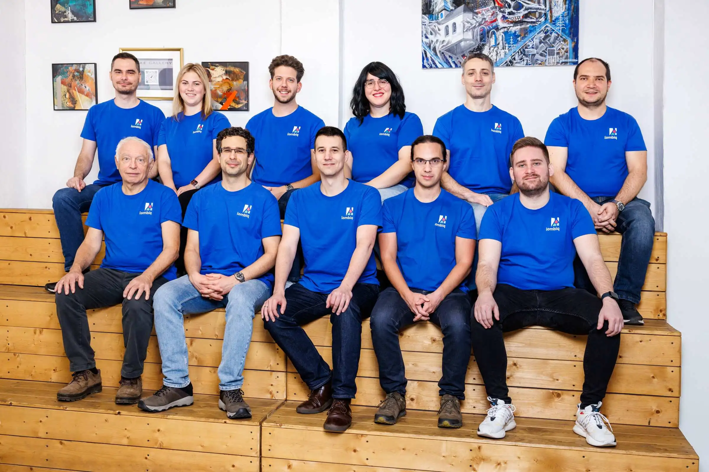

# Lombiq Technologies

[Lombiq Technologies](https://lombiq.com) builds, modernizes, and rescues mission-critical web applications, then supports them for as long as our clients need. Clients keep control of the code and the direction; we can run the hosting and operations, or prepare their team to take over.

Most of what we build runs on .NET and [Orchard Core](https://orchardcore.net/), and we contribute directly to Orchard Core itself. Many of the modules and tools we use in client work are open-source and live here.

## Our services

### Mission-critical web platforms

New platforms built around how an organization actually works, modernization in controlled steps, and recovery when releases fail or delivery has stalled. This includes turning AI-built prototypes into production software and building multi-tenant platforms. See [how we work](https://lombiq.com/mission-critical-web-platforms).

### Software audits and technical due diligence

An independent review of a codebase, its delivery process, and its operating constraints before an acquisition, investment, or major platform change. See [software audits](https://lombiq.com/software-audit).

### Enterprise data, analytics, and AI

Connecting and cleaning up scattered data first, then adding analytics, machine learning, or AI where it improves a real decision. See [data and AI solutions](https://lombiq.com/ai-process-automation).

### Orchard Core development, consulting, and training

For teams already using or evaluating Orchard Core. Our [Orchard Dojo](https://orcharddojo.net/) site has tutorials and a weekly recap of what's happening in Orchard Core. See [Orchard Core expertise](https://lombiq.com/orchard-core).

## Products

- [**DotNest**](https://dotnest.com/) is our managed Orchard Core hosting platform. It has hosted Orchard sites since 2014, with more than 7,300 sites created.
- [**Hastlayer**](https://hastlayer.com/) turns performance-critical sections of .NET programs into computer chips (FPGA). You can still update your software, but it will be a whole lot faster and more power-efficient.

## Our team

Lombiq's team consists of highly skilled experts from diverse backgrounds:

## Open-source and open hearts

Apart from [our activities in the open-source world](https://lombiq.com/open-source), we also try to help other communities with our philanthropic activities. We've delivered thousands of reusable masks to the Hungarian Charity Service of the Order of Malta during the coronavirus pandemic, and helped refugees of the war in Ukraine, more than once.

# Would you like to contribute to our projects?

To contribute to one of our projects, read our [contribution guidelines](https://lombiq.com/open-source-guidelines) first. You can also support the projects we sponsor, with code or funding.

You can also check our profile on [NuGet](https://www.nuget.org/profiles/Lombiq) with packages for our open-source projects.

Would you like to get in touch with us? Feel free to reach out to us through our social media accounts:
* [X](https://x.com/Lombiq)
* [YouTube](https://www.youtube.com/c/LombiqTechnologies)
* [LinkedIn](https://www.linkedin.com/company/3162451/)

Or you can [tell us about your problem here](https://lombiq.com/contact-us).
